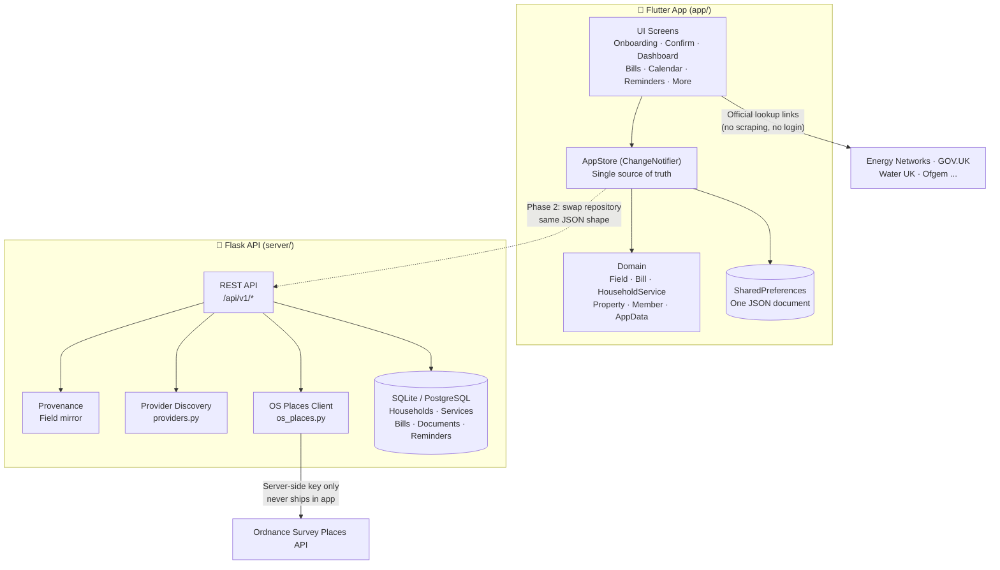
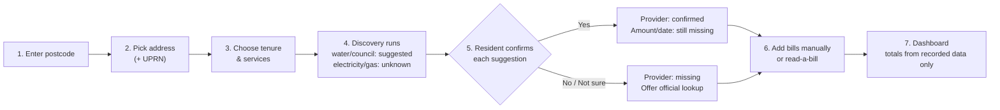

# 🏠 MoveIn — HomeLedger

> **A UK-first household bill tracker built around one honest rule:**
>
> *An address tells you which services a home has. It cannot tell you who bills you, how much you pay, or when it is due.*

**MoveIn** (product name: **HomeLedger**) helps you move into a new home without the spreadsheet chaos. Enter your address **once**, let the app work out which household services apply, get honest suggestions for providers it *can* suggest, and confirm the rest yourself. Money only appears on your dashboard when it comes from a real bill, a statement, or your own words — never from a guess.


---

## 📑 Table of Contents

- [About the Project](#-about-the-project)
- [Why HomeLedger?](#-why-homeledger)
- [The Core Idea: Provenance](#-the-core-idea-provenance)
- [Features](#-features)
- [Screenshots & Demo](#-screenshots--demo)
- [Tech Stack](#-tech-stack)
- [Architecture](#-architecture)
- [Project Structure](#-project-structure)
- [Getting Started](#-getting-started)
  - [Prerequisites](#prerequisites)
  - [Clone the Repo](#clone-the-repo)
  - [Run the Flutter App](#run-the-flutter-app)
  - [Run the API Server](#run-the-api-server)
  - [Environment Variables](#environment-variables)
- [How It Works — User Journey](#-how-it-works--user-journey)
- [API Reference](#-api-reference)
- [Data Model](#-data-model)
- [Data Sources — Honestly Stated](#-data-sources--honestly-stated)
- [Testing](#-testing)
- [Roadmap](#-roadmap)
- [What Is Deliberately Not Implemented](#-what-is-deliberately-not-implemented)
- [Security, Privacy & Compliance](#-security-privacy--compliance)
- [Contributing](#-contributing)
- [License](#-license)
- [Acknowledgements](#-acknowledgements)

---

## 📖 About the Project

**MoveIn / HomeLedger** is a monorepo containing two parts that work together:

```
MoveIn/
├── app/      → Flutter app (local-first; no backend required to run the whole journey)
└── server/   → Flask API scaffold: address lookup proxy, provider discovery, records
```

| Part | What it does |
|------|--------------|
| **`app/`** | Cross-platform Flutter app for Android, iOS, Web & macOS. Local-first — all data lives on-device in `SharedPreferences` as a single JSON document. You can run the *entire* user journey offline with the built-in demo catalogue. |
| **`server/`** | Python/Flask REST API. Keeps licensed address-provider keys off the device, turns a postcode into honest provider suggestions, and stores households, services, bills, documents and reminders **with provenance on every value**. |

The app and the API share the **exact same data shape** (`Field<T>` provenance model), so moving from local storage to a server-backed repository is a contained change — no data translation needed.

---

## 💡 Why HomeLedger?

Moving house in the UK means suddenly juggling:

- Electricity & gas suppliers (often *different* companies)
- Water & wastewater companies (regional, sometimes different from each other)
- Council tax (band, account number, instalments)
- Broadband, TV Licence, home insurance
- Rent / mortgage, meter readings, contract renewals

Most bill apps either:

1. **Guess** — inferring your supplier from your postcode and showing it as fact, or
2. **Start empty** — making you type everything from scratch with no guidance.

HomeLedger does neither. It:

- ✅ **Suggests only what it can honestly suggest** (e.g. your regional water company from postcode)
- ✅ **Explicitly says "unknown"** for things an address cannot tell you (e.g. electricity/gas supplier)
- ✅ **Asks you to confirm** every suggestion with a clear Yes / No / Not sure prompt
- ✅ **Never invents money** — amounts and dates only appear when you enter them or they are read from a bill you provided
- ✅ **Shows its working** — every value carries a badge like *"Suggested · postcode lookup"* or *"Confirmed by you"*

> **The confirmation screen is the heart of the product, not the dashboard.**

---

## 🔑 The Core Idea: Provenance

Every value in the app is stored as a `Field<T>` (`app/lib/domain/field.dart`):

```dart
class Field<T> {
  final T? value;           // the value itself
  final FieldSource source; // where it came from
  final FieldStatus status; // how much we trust it
  final String? note;       // why it exists
  final DateTime? recordedAt; // when
}
```

| Part | Possible values |
|------|-----------------|
| `source` | `userEntered`, `userConfirmed`, `postcodeLookup`, `officialLookup`, `billExtraction`, `estimate`, `none` |
| `status` | `missing`, `suggested`, `confirmed` |

### Consequences you can see throughout the code

| Rule | What happens |
|------|--------------|
| **Postcode-derived water company** | Stored as `suggested` + `postcodeLookup`. Renders with a *"Suggested · postcode lookup"* badge and a Yes / No / Not sure prompt. Never displayed as fact. |
| **Electricity & gas suppliers** | **Never inferred from an address.** Discovery returns `confidence: "unknown"` and offers the official lookup, a bill upload, or manual entry. |
| **Confirming a provider ≠ confirming money** | Provider, account number, amount and next-due-date are *separate* fields with separate sources. Confirming the water company leaves "Amount" and "Next payment" empty. |
| **Missing dates stay missing** | A bill with an amount but no date is listed under *"Needs details"*, excluded from totals, and generates **no reminder**. |
| **Estimates are quarantined** | `FieldSource.estimate` amounts live in an *"Estimates (not counted)"* section and never touch *"Monthly bills"* or *"Still to pay"*. |
| **Totals always reconcile** | Dashboard totals are computed from recorded data only (`app/lib/domain/household_summary.dart`), so the headline figure always matches the list underneath it. |

The server mirrors this exactly in `server/home_ledger/provenance.py` — the API contract is identical to the client model.

---

## ✨ Features

### 🏠 Onboarding — "Enter your address once"
- UK postcode validation & normalisation (`BS1 4DJ` format)
- Address search (demo catalogue offline; live OS Places via API when configured)
- Pick your exact address (with UPRN where available) or enter manually
- Choose tenure: renting / owning / other
- Choose which services to track (defaults: electricity, gas, water, wastewater, council tax)
- **"Explore the example household instead"** — loads a complete worked example (see Demo below)

### ✅ Confirmation Screen — the heart of HomeLedger
- Runs provider discovery for your postcode
- Water / wastewater / council tax come back as **suggestions** with confidence levels (`areaCertain`, `areaOnly`)
- Electricity / gas come back as **explicitly unknown** with links to official lookups
- Each suggestion: **Yes / No / Not sure** — with provenance badge and plain-English explanation
- Detail sheets per service: provider, account number, amount, next due date — each confirmed separately
- Official lookup links (Energy Networks, Gas Supplier Database, Water UK, GOV.UK, TV Licensing, Ofgem) opened in-browser via `url_launcher`

### 📊 Dashboard
- **Monthly bills** — sum of confirmed recurring amounts (monthly-equivalent)
- **Still to pay** — confirmed, non-estimated bills due within the horizon + overdue
- **Upcoming** — next bills sorted by due date
- **Needs attention** — unresolved providers, missing dates, overdue bills
- **Estimates (not counted)** — quarantined forecasts, clearly separated
- Role-aware: viewers see `••••` instead of amounts

### 🧾 Bills
- List, detail, manual entry, and **"Read a bill"** (paste/typed bill text → rule-based parser → field-by-field review)
- Bill states: `paid`, `overdue`, `dueSoon`, `upcoming`, `needsDetails`
- Payment status: `unknown` (honest default) / `scheduled` / `paid`
- Frequencies: weekly, fortnightly, monthly, quarterly, yearly, one-off
- Billing period start/end, notes, linked document

### 📅 Calendar & ⏰ Reminders
- Calendar view of due dates
- In-app reminders (payment due, contract renewal, meter reading, custom)
- No reminder is ever generated for a bill without a date

### 👥 More — Household Management
- **Documents** — bill / statement / meter reading / receipt / policy records (with `storageKey` hook for encrypted server storage)
- **Members & Roles** — owner / tenant / housemate / viewer with permissions (`canEditBills`, `canManageHousehold`, `canSeeAmounts`)
- **Spending** — monthly spend table (confirmed amounts only, grouped by due-date month)
- **Privacy** — what data is stored, where, and how to erase it
- **Load the example household** / reset demo data

### 📱 App Shell
- 5-tab bottom navigation: **Home · Bills · Calendar · Reminders · More**
- Root gate logic: no address → onboarding → unconfirmed providers → confirmation → dashboard
- Material 3 theme (light + dark, follows system), deliberately avoids volatile sub-themes

---

## 📸 Screenshots & Demo

> Screenshots are not yet committed. Run the app and explore the demo household to see the full flow.

### Try it in 30 seconds (no backend needed)

1. Run the app (`flutter run`)
2. On the address screen, tap **"Explore the example household instead"**
3. You get a complete worked example:
   - ✅ One **confirmed** provider
   - ⏳ One **suggestion awaiting** your answer
   - 🧾 One bill **with no payment date** (shows "Needs details", excluded from totals)
   - 🔮 One **estimate** (quarantined, not counted)
   - 👥 Three household roles (owner / tenant / viewer)
4. Everything is marked `(demo)` and *"Illustrative example, not a live address lookup"* — demo UPRNs are fake sequences, not real UPRNs.

---

## 🛠 Tech Stack

### Flutter App (`app/`)
| Technology | Version | Purpose |
|------------|---------|---------|
| Flutter | ≥ 3.22.0 | Cross-platform UI (Android, iOS, Web, macOS) |
| Dart | ≥ 3.3.0 | Language |
| `shared_preferences` | ^2.2.3 | Local persistence (single JSON document) |
| `url_launcher` | ^6.2.6 | Open official provider-lookup pages in browser |
| `flutter_lints` | ^4.0.0 | Linting (dev) |

*Only two runtime dependencies — deliberately minimal.*

### API Server (`server/`)
| Technology | Version | Purpose |
|------------|---------|---------|
| Python | ≥ 3.10 | Language |
| Flask | 3.0.3 | REST API framework |
| Flask-SQLAlchemy | 3.1.1 | ORM |
| Flask-Cors | 4.0.1 | CORS for web build |
| SQLAlchemy | 2.0.31 | Database toolkit |
| requests | 2.32.3 | OS Places HTTP client |
| python-dotenv | 1.0.1 | Env config |
| gunicorn | 22.0.0 | Production WSGI server |
| pytest | 8.2.2 | Tests (dev) |

Database: **SQLite** locally, **PostgreSQL** in deployment (via `DATABASE_URL`).

---

## 🏗 Architecture



**Key architectural decisions:**

- **Local-first:** The app works fully offline. The API is a scaffold for Phase 2 — swapping `AppStore` for an HTTP-backed repository is a contained change because the JSON shapes match.
- **Secrets stay server-side:** The OS Places API key lives only in `server/home_ledger/config.py` env vars. The app never talks to Ordnance Survey directly.
- **No scraping, no account login:** The app links to official lookup pages; it does not scrape utility websites or log into provider accounts on anyone's behalf.
- **One aggregate:** `AppData` is the whole local state — property + services + bills + documents + reminders + members. The API's `GET /api/v1/households/<id>` returns the same shape.

---

## 📁 Project Structure

```
MoveIn/
├── README.md                  ← you are here
├── .gitignore
│
├── app/                       ← Flutter app
│   ├── pubspec.yaml           ← name: home_ledger, v0.1.0+1
│   ├── analysis_options.yaml
│   ├── lib/
│   │   ├── main.dart          ← bootstrap: load store before first frame
│   │   ├── app.dart           ← MoveInApp + RootGate (setup → confirm → dashboard)
│   │   ├── theme.dart         ← Material 3 theme (light/dark)
│   │   ├── core/
│   │   │   ├── format.dart    ← money/date formatting (minor units, GBP)
│   │   │   └── json.dart      ← forgiving JSON helpers (asMap, asInt, asDateTime…)
│   │   ├── domain/            ← pure Dart, no Flutter deps (testable)
│   │   │   ├── field.dart     ← Field<T>, FieldSource, FieldStatus ★
│   │   │   ├── enums.dart     ← ServiceKind, Tenure, MemberRole, PaymentFrequency…
│   │   │   ├── property.dart  ← Property + AddressCandidate
│   │   │   ├── household_service.dart ← HouseholdService (service slot)
│   │   │   ├── bill.dart      ← Bill + BillState
│   │   │   ├── document.dart  ← DocumentRecord + Reminder
│   │   │   ├── member.dart    ← Member + roles
│   │   │   ├── app_data.dart  ← AppData (whole local state, v1 JSON)
│   │   │   └── household_summary.dart ← totals, upcoming, monthlySpend ★
│   │   ├── data/
│   │   │   ├── store.dart     ← AppStore: ChangeNotifier + persistence ★
│   │   │   ├── demo_data.dart ← worked example household
│   │   │   ├── lookup/
│   │   │   │   ├── address_lookup_service.dart  ← interface + UK postcode utils
│   │   │   │   ├── demo_address_catalogue.dart  ← offline demo addresses
│   │   │   │   ├── provider_lookup_service.dart ← discovery + suggestions
│   │   │   │   └── lookup_links.dart            ← official lookup URLs
│   │   │   └── extraction/
│   │   │       └── bill_text_parser.dart        ← rule-based bill parser (OCR seam)
│   │   └── ui/
│   │       ├── scope.dart     ← InheritedNotifier for the store
│   │       ├── shell.dart     ← 5-tab HomeShell
│   │       ├── widgets/       ← AppCard, provenance badges, field rows, bill tile
│   │       └── screens/
│   │           ├── onboarding/   ← address → tenure → services
│   │           ├── confirm/      ← confirmation screen + detail sheets ★
│   │           ├── dashboard/    ← totals, upcoming, attention, estimates
│   │           ├── bills/        ← list, detail, add, read-a-bill
│   │           ├── calendar/     ← calendar view
│   │           ├── reminders/    ← reminders list
│   │           ├── lookup/       ← lookup sheet
│   │           └── more/         ← documents, members, spending, privacy
│   ├── test/
│   │   ├── field_test.dart        ← provenance rules
│   │   ├── summary_test.dart      ← summary arithmetic
│   │   ├── extraction_test.dart   ← bill text parsing
│   │   └── widget_test.dart       ← 3 widget flows
│   ├── web/  macos/               ← platform runners
│   └── README.md
│
└── server/                    ← Flask API
    ├── run.py                 ← dev entry point (0.0.0.0:5000)
    ├── requirements.txt
    ├── requirements-dev.txt   ← + pytest
    ├── home_ledger/
    │   ├── __init__.py        ← app factory, health, DB bootstrap
    │   ├── config.py          ← env config (secrets server-side only)
    │   ├── extensions.py      ← SQLAlchemy instance
    │   ├── models.py          ← Household, Property, Member, ServiceSlot, Bill, Document, Reminder
    │   ├── provenance.py      ← server mirror of Flutter Field ★
    │   ├── api.py             ← HTTP routes + serialisation ★
    │   └── lookups/
    │       ├── os_places.py   ← licensed address lookup (server-side key)
    │       └── providers.py   ← honest discovery + official lookup links
    ├── tests/
    │   └── test_api.py        ← 14 tests (provenance, discovery, guards)
    └── README.md
```

★ = start here if you want to understand the product rules.

---

## 🚀 Getting Started

### Prerequisites

| Tool | Version | Check |
|------|---------|-------|
| Flutter | ≥ 3.22.0 | `flutter --version` |
| Dart | ≥ 3.3.0 | bundled with Flutter |
| Python | ≥ 3.10 | `python3 --version` |
| pip | latest | `pip --version` |

### Clone the Repo

```bash
git clone https://github.com/HammadBullah/MoveIn.git
cd MoveIn
```

### Run the Flutter App

```bash
cd app
flutter pub get
flutter test          # unit + widget tests
flutter run           # pick a device (Android / iOS / Chrome / macOS)
```

**First launch flow:**

```
Enter postcode (e.g. BS1 4DJ)
  → Pick an address (or enter manually)
  → Choose tenure + services
  → Confirmation screen runs discovery
  → Confirm / reject each suggestion
  → Dashboard
```

> 💡 No backend needed. The app ships with a demo address catalogue so the whole journey works offline.

### Run the API Server

```bash
cd server
python3 -m venv .venv && source .venv/bin/activate
pip install -r requirements-dev.txt
python run.py                 # http://0.0.0.0:5000
pytest                        # 14 tests, all passing
```

Every request except `GET /api/health` needs the header:

```
X-API-Key: dev-local-key
```

> ⚠️ The shared key is a **development placeholder**. Replace with real authentication before deploying (see [Security](#-security-privacy--compliance)).

### Environment Variables

See `server/home_ledger/config.py`:

| Variable | Default | Purpose |
|----------|---------|---------|
| `DATABASE_URL` | `sqlite:///home_ledger.db` | SQLite locally, PostgreSQL in deployment (`postgresql+psycopg://…`) |
| `ADDRESS_PROVIDER` | `demo` | `demo` (sample catalogue) or `os_places` (live) |
| `OS_PLACES_API_KEY` | *(empty)* | Ordnance Survey Places key — **server-side only, never in the app** |
| `OS_PLACES_URL` | `https://api.os.uk/search/places/v1/postcode` | OS Places endpoint |
| `ADDRESS_LOOKUP_TIMEOUT_SECONDS` | `6` | Lookup timeout |
| `API_KEY` | `dev-local-key` | Placeholder shared key — replace with real auth |
| `CORS_ORIGINS` | `*` | Allowed origins for the web build |
| `DOCUMENT_BUCKET` | *(empty)* | Encrypted document storage target (S3-compatible) |
| `DOCUMENT_STORAGE_MODE` | `local` | `local` or bucket storage |
| `MAX_UPLOAD_BYTES` | `10485760` (10 MB) | Max document upload size |
| `SECRET_KEY` | `dev-only-change-me` | Flask secret — set a real one in production |
| `PORT` | `5000` | Server port |
| `FLASK_DEBUG` | `1` | Debug mode |

**Live address lookup:**

```bash
export ADDRESS_PROVIDER=os_places
export OS_PLACES_API_KEY=your-key-here
python run.py
```

Without a key (or with `ADDRESS_PROVIDER=demo`), the API returns the sample catalogue with `"isLive": false` so the client can label it honestly.

> 📋 Before commercial use, check OS Places licence terms, pricing, caching rules, and whether storing UPRN + formatted address is permitted.

---

## 🔄 How It Works — User Journey



**Step by step:**

1. **Enter postcode** — validated for UK format, normalised to `OUTWARD INWARD`.
2. **Pick address** — from lookup results (demo or live OS Places via API), or enter manually.
3. **Choose tenure & services** — renting/owning/other; tick the services this home has.
4. **Discovery** — the app suggests water/wastewater/council from postcode region; electricity/gas are returned as *unknown* with official lookup links.
5. **Confirm** — each suggestion gets a provenance badge and a Yes / No / Not sure prompt. Confirming a provider does **not** confirm an amount or date.
6. **Add bills** — manually, or paste bill text into "Read a bill" and review each extracted field. A bill needs an amount; a payment date is optional (and honestly stays missing if unknown).
7. **Dashboard** — monthly recurring total, still-to-pay, upcoming, needs-details, and quarantined estimates — all computed from confirmed data only.

---

## 📡 API Reference

Base URL: `http://0.0.0.0:5000` · All endpoints except `/api/health` require `X-API-Key` header.

| Method | Endpoint | Description |
|--------|----------|-------------|
| `GET` | `/api/health` | Health check (no auth) |
| `GET` | `/api/v1/lookups` | Official lookup links (so client doesn't hardcode them) |
| `POST` | `/api/v1/addresses/search` | `{postcode}` → address candidates (`isLive` flag) |
| `POST` | `/api/v1/households` | Create household — every service slot starts **empty** (provider/amount/date all `missing`) |
| `GET` | `/api/v1/households/<id>` | Get household (property, services, bills, members…) |
| `POST` | `/api/v1/households/<id>/discover` | Provider discovery — water/council `suggested`, electricity/gas `unknown`. **Never overwrites resident-entered values.** |
| `PATCH` | `/api/v1/services/<id>` | Update a service. `{"provider": {"action": "confirm"}}` confirms **only** the provider. |
| `POST` | `/api/v1/households/<id>/bills` | Create bill — **amount required** (`400` otherwise); payment date optional |
| `PATCH` | `/api/v1/bills/<id>` | Update bill fields |
| `DELETE` | `/api/v1/bills/<id>` | Delete bill |
| `POST` | `/api/v1/households/<id>/reminders` | Create reminder |
| `PATCH` | `/api/v1/reminders/<id>` | Update reminder |
| `DELETE` | `/api/v1/reminders/<id>` | Delete reminder |
| `POST` | `/api/v1/households/<id>/documents` | Register document |
| `GET` | `/api/v1/households/<id>/documents` | List documents |

Full contracts are documented at the top of `server/home_ledger/api.py`.

### Example session

```bash
KEY='X-API-Key: dev-local-key'

# 1. Create a household — every provider is empty, on purpose
curl -s -X POST localhost:5000/api/v1/households -H "$KEY" \
  -H 'Content-Type: application/json' -d '{
  "address": {"line1": "12 Example Street", "town": "Bristol",
              "postcode": "BS1 4DJ", "uprn": "DEMO-0000000012"},
  "tenure": "renting",
  "services": ["electricity", "gas", "water", "wastewater", "councilTax"],
  "residentName": "Sam"
}'

# 2. Discover providers — water/council "suggested", electricity/gas unknown
curl -s -X POST localhost:5000/api/v1/households/<id>/discover -H "$KEY"

# 3. Confirm exactly one provider — amount/date stay missing
curl -s -X PATCH localhost:5000/api/v1/services/<service-id> -H "$KEY" \
  -H 'Content-Type: application/json' -d '{"provider": {"action": "confirm"}}'

# 4. Add a bill — amount required, payment date optional
curl -s -X POST localhost:5000/api/v1/households/<id>/bills -H "$KEY" \
  -H 'Content-Type: application/json' \
  -d '{"kind": "water", "amountMinor": 9000, "provider": "Wessex Water"}'
```

### Field JSON shape (client ↔ server, identical)

```json
{
  "value": "Wessex Water",
  "source": "postcodeLookup",
  "status": "suggested",
  "recordedAt": "2026-11-10T12:00:00+00:00",
  "note": "Sample regional lookup. Confirm this is the company that bills you."
}
```

---

## 🗄 Data Model

### Core types

| Type | Where | What it is |
|------|-------|------------|
| `Field<T>` | `app/lib/domain/field.dart` · `server/home_ledger/provenance.py` | Value + source + status + note + recordedAt |
| `Property` | `property.dart` · `models.py: Property` | Address: line1/line2, town, postcode, UPRN, tenure, address source, demo flag |
| `HouseholdService` | `household_service.dart` · `models.py: ServiceSlot` | One service slot: provider, account number, amount, next due date (each a `Field`), frequency, lookup keys |
| `Bill` | `bill.dart` · `models.py: Bill` | One charge: kind, provider, amount, due date (each a `Field`), period, frequency, payment status, document link |
| `DocumentRecord` | `document.dart` · `models.py: Document` | Uploaded/registered document (bill, statement, meter reading, receipt, policy) |
| `Reminder` | `document.dart` · `models.py: Reminder` | Payment / renewal / meter reading / custom reminder |
| `Member` | `member.dart` · `models.py: Member` | Household member + role (owner/tenant/housemate/viewer) |
| `AppData` | `app_data.dart` | Whole local state: property + services + bills + documents + reminders + members (JSON v1) |
| `HouseholdSummary` | `household_summary.dart` | Computed totals: monthly recurring, still to pay, upcoming, needs details, estimates, overdue |

### Service kinds

`electricity` · `gas` · `water` · `wastewater` · `councilTax` · `broadband` · `tvLicence` · `homeInsurance` · `other`

### Money handling

All amounts are stored as **minor units** (pence) as integers — `9000` means £90.00. Formatting to GBP happens only at display time (`app/lib/core/format.dart`). This avoids floating-point errors.

### Database (server)

SQLAlchemy models in `server/home_ledger/models.py`: `Household`, `Property`, `Member`, `ServiceSlot`, `Bill`, `Document`, `Reminder`. Provenance fields (`provider`, `account_number`, `amount_minor`, `next_due_date`, `due_date`) are stored as **JSON columns** shaped exactly like the Flutter `Field` type.

---

## 📊 Data Sources — Honestly Stated

| Information | Where it comes from | Automatic? |
|-------------|---------------------|------------|
| Exact address + UPRN | Licensed address provider (OS Places) **via the API** | Yes |
| Water / sewerage company | Postcode lookup (regional) | Often (still needs confirming) |
| Local council / band | Postcode lookup, GOV.UK | Usually (band only) |
| Electricity / gas supplier | Official supplier lookup, network operator, or a bill | **No** — not from the address |
| Council tax account, balance, instalments | Council, bill upload, manual entry | No |
| Bill amounts and dates | Bill upload, provider integration, manual entry | Only with evidence |
| Payment status | Bill evidence or authorised financial data | Partly |
| Bank payment dates | Open Banking, with explicit consent | Later version, with an FCA-authorised provider |

Sample tables live in `server/home_ledger/lookups/providers.py` and `app/lib/data/lookup/provider_lookup_service.dart`. They exist to demo the flow and are labelled sample/demo. **Do not ship them as a real mapping.**

The Open Banking path is deliberately not implemented: a bank transaction is not proof a bill was paid, and matching it correctly is a product of its own.

---

## 🧪 Testing

### Server

```bash
cd server
pytest -q        # 14 passed
```

Tests assert the **product rules**, not just plumbing: suggestions are never confirmed implicitly, discovery never overwrites a resident's answer, confirming a provider leaves amounts missing, and a bill cannot be created without an amount.

### App

```bash
cd app
flutter test
```

Included: field provenance, bill states, summary arithmetic, bill-text parsing, JSON round-trips, and three widget flows (`app/test/`).

> ⚠️ **Verification status:** Server tests pass in this repository. App tests are included but **have not been executed in the original workspace** (no Flutter SDK was available there). Run `flutter test` before relying on them.

Tests to read first, because they encode the product rules:

```bash
cd app && flutter test test/summary_test.dart test/extraction_test.dart
```

---

## 🗺 Roadmap

| Phase | Scope | Status |
|-------|-------|--------|
| **Phase 1** | Address selection, manual bills, confirmation states, dashboard, calendar, reminders, roles, documents | ✅ Done (this repo) |
| **Phase 2** | Wire the API, live address lookup (server-side key), provider discovery with licensed reference dataset, magic-link auth + per-household authorisation | 🔜 Next |
| **Phase 3** | Bill upload, OCR, field-by-field confirmation, document history | Planned |
| **Phase 4** | Shared households across devices, recurring-payment matching, authorised Open Banking with consent | Planned |
| **Phase 5** | Broader regional support, provider partnerships, carefully validated automation | Future |

---

## 🚫 What Is Deliberately Not Implemented

- **File upload and OCR.** The "Read a bill" screen takes pasted/typed text, parses it with `BillTextParser`, and asks the resident to confirm each field. Real uploads plug in at exactly that seam: OCR → text → the same review screen. `DocumentRecord.storageKey` is the hook for encrypted server storage.
- **Push/local notifications.** Reminders are in-app and the UI says so. Delivery needs a platform plugin, plus a server-side scheduler for a shared household.
- **Authentication and access control.** Roles are enforced in the UI (`MemberRole`) and must be re-enforced server-side. The API's shared key is a development placeholder.
- **Open Banking.** Phase 4, with consent, an authorised provider, and careful transaction matching.
- **Real provider dataset.** Sample tables are demo-only; a licence-reviewed reference dataset must replace them before launch.

---

## 🔒 Security, Privacy & Compliance

**Before real households use this, the following must land:**

- [ ] Real authentication (sessions / magic link) + per-household authorisation on every route
- [ ] Encrypted document upload (streaming, size limits, virus scanning) + retention/erasure policy
- [ ] Alembic migrations instead of `db.create_all()`
- [ ] Rate limiting on address lookups (they cost money)
- [ ] Audit log of who changed which value, and when
- [ ] Licence-reviewed provider reference dataset
- [ ] Reminder scheduler (Celery/RQ or cron worker) with idempotent delivery

**Compliance notes:**

- "HomeLedger" is a working name: check domain, app-store and trademark availability before launch.
- Ordnance Survey Places terms and pricing must be checked before commercial use.
- UK GDPR duties apply as soon as real households use this: lawful basis, minimal collection, retention/erasure, and an audit log.
- HomeLedger is not affiliated with any energy, water or council provider, and it does not pay bills.

---

## 🤝 Contributing

Contributions are welcome! Please:

1. **Fork** the repo and create a feature branch (`git checkout -b feature/your-feature`).
2. **Follow the provenance rule** — any new value must carry a `Field` with source + status. Never display a suggestion as fact.
3. **Add tests** — product-rule tests belong in `app/test/` and `server/tests/test_api.py`.
4. **Run the checks:**
   ```bash
   cd app && flutter test && flutter analyze
   cd server && pytest -q
   ```
5. **Open a pull request** with a clear description of what changed and why.

### Code conventions

- **Dart:** `flutter_lints` rules; domain layer (`app/lib/domain/`) stays dependency-free (no Flutter imports) so it can be unit-tested and reused.
- **Python:** Type hints throughout; keep `SOURCES`/`STATUSES` in `provenance.py` in sync with `field.dart`.
- **Commits:** Short imperative subject, e.g. `feat: confirm provider without confirming amount`.

---

## 📄 License

No license has been added yet — **all rights reserved** by default. Before accepting contributions or going public, add a `LICENSE` file (MIT or Apache-2.0 recommended for this kind of project).

---

## 🙏 Acknowledgements

- **Ordnance Survey Places** — licensed address lookup (server-side)
- **Energy Networks Association**, **Gas Supplier Database**, **Water UK**, **GOV.UK**, **TV Licensing**, **Ofgem** — official lookup destinations linked from the app
- Built with **Flutter** & **Flask**

---

<div align="center">

**MoveIn · HomeLedger** — *Enter your address once. Confirm what you actually know. Track only what's real.*

</div>
